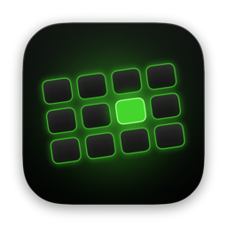
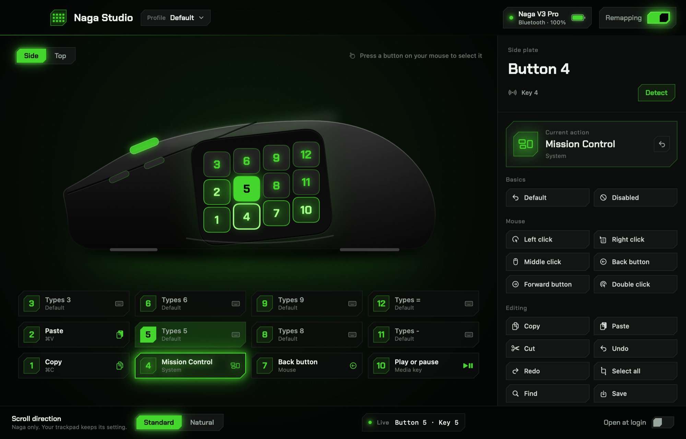
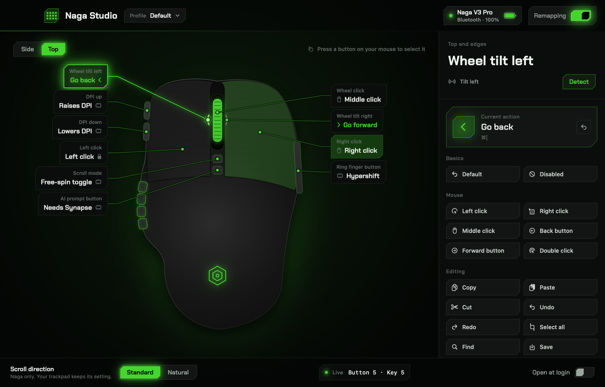

<p align="center">
  
</p>

<h1 align="center">Naga Studio</h1>

<p align="center">
  An open-source macOS app for the Razer Naga V3 Pro.<br>
  Remap the buttons, set the scroll direction, and see the battery in your menu bar.
</p>

<p align="center">
  <a href="https://github.com/marclou/naga-studio/releases/latest"><b>Download for macOS</b></a>
</p>



## Features

- **Scroll direction for the Naga only.** Pick standard or natural scrolling for the mouse while your trackpad keeps its own setting.
- **Remap buttons.** The 12 side buttons, right click, wheel click and wheel tilt can trigger mouse clicks, copy and paste, tabs, Mission Control, Spotlight, screenshots, media keys, any keyboard shortcut you record, a text snippet, or an app.
- **Live view.** Buttons light up on the drawing as you press them, and pressing a button selects it.
- **Profiles.** Keep separate button setups and switch between them from the window or the menu bar.
- **Battery in the menu bar.** Read over Bluetooth from the mouse itself.
- **Detect.** If a button sends something unexpected, press Detect and then the button to bind it.
- Runs in the background and can open at login.



## Install

1. Download `Naga-Studio-<version>.zip` from the [latest release](https://github.com/marclou/naga-studio/releases/latest), unzip it, and drag **Naga Studio** to your Applications folder.
2. Open it. The app isn't notarized by Apple, so macOS blocks the first launch. Go to **System Settings → Privacy & Security**, scroll down, and click **Open Anyway**.
   If macOS says the app is damaged, run this once in Terminal:
   ```sh
   xattr -dr com.apple.quarantine "/Applications/Naga Studio.app"
   ```
3. Allow **Accessibility** when asked (System Settings → Privacy & Security → Accessibility → Naga Studio). macOS requires it before any app can read and remap input.
4. Allow **Bluetooth** when asked. It's only used to read the battery level.

Requires macOS 15 or later on Apple silicon or Intel. Tested with the Naga V3 Pro over Bluetooth.

## Build from source

You need Xcode 26 (Swift 6.2).

```sh
git clone https://github.com/marclou/naga-studio.git
cd naga-studio
./scripts/build-app.sh --install
```

The script builds a universal app into `build/` and installs it in `/Applications`. Builds are ad-hoc signed, so macOS asks for Accessibility again after each rebuild. To keep the permission, sign with your own certificate:

```sh
SIGN_IDENTITY="Apple Development" ./scripts/build-app.sh --install
```

`./scripts/build-app.sh --zip` also packages a zip for a release, and `NagaStudio --render-preview <folder>` renders the screenshots above.

## How it works

- **No kernel extension.** Naga Studio is a user-space driver: an event tap sees input before other apps do and rewrites what comes from the Naga.
- **Only the Naga is touched.** Each event is matched to the device that sent it, so your keyboard and trackpad pass through as they are.
- **Battery** comes from Razer's Bluetooth vendor service, using the protocol documented by [open-snek](https://github.com/gh123man/open-snek).
- **Privacy.** The app has no network code, no analytics and no accounts. Settings stay in your Mac's user defaults.

## Limitations

- DPI, scroll mode, the AI Prompt button and the ring finger button are handled by the mouse and usually send nothing to the Mac. Detect shows whether one does.
- Left click can't be remapped, so you can't lock yourself out.
- Some Naga units report a full battery until the battery gauge calibrates after a full charge.
- Only the Naga V3 Pro has been tested. Other Naga models may work.

## Credits

- Razer Bluetooth protocol notes: [open-snek](https://github.com/gh123man/open-snek)
- Font: [Chakra Petch](https://fonts.google.com/specimen/Chakra+Petch), SIL Open Font License 1.1

## License

[MIT](LICENSE). Naga Studio isn't affiliated with or endorsed by Razer. Razer and Naga are trademarks of Razer Inc.
